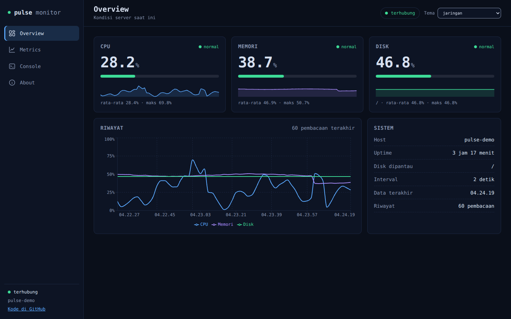
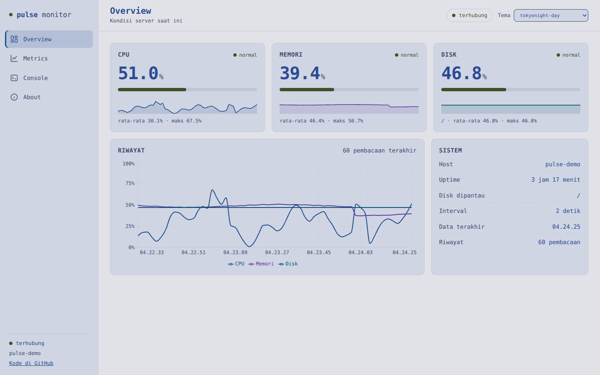
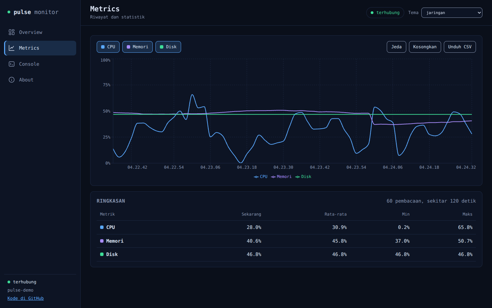
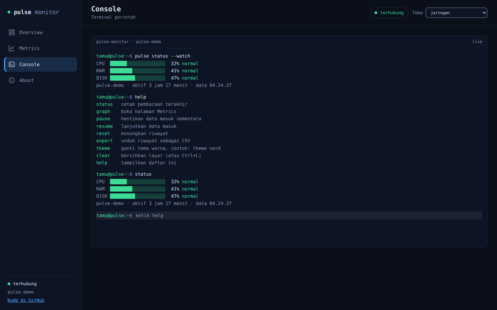
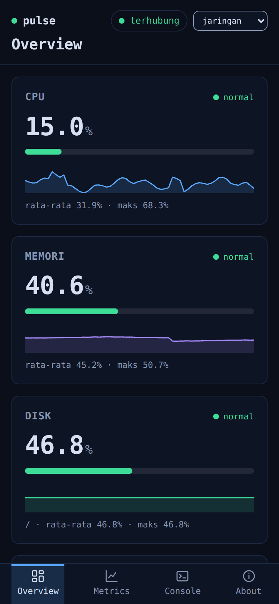
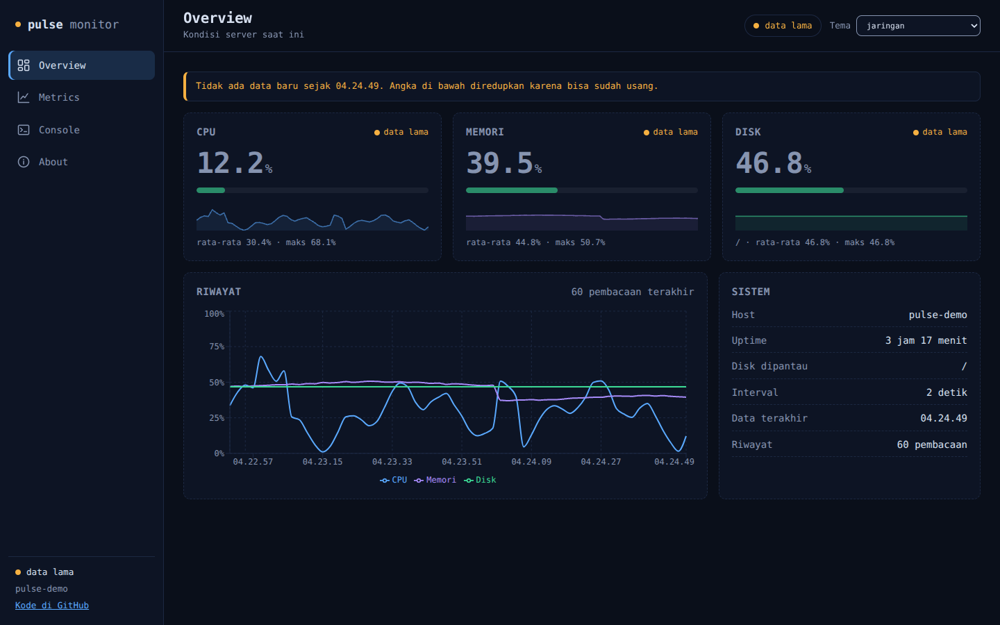

# Pulse Monitor

Dashboard untuk memantau CPU, RAM, dan disk server secara langsung dari browser. API Python membaca metrik dengan psutil, FastAPI menyiarkannya lewat SSE, dan React menampilkannya sebagai bar teks, grafik garis, dan terminal yang bisa diketik.

## Tampilan

| Tema terang | Metrics | Console |
|---|---|---|
|  |  |  |

| Mobile | Data lama (API berhenti mengirim) |
|---|---|
|  |  |

Tangkapan layar diambil dari server demo yang mengirim data sintetis dengan kontrak API yang sama (divalidasi terhadap model Pydantic API asli), supaya grafiknya representatif. Frontend-nya sama dengan yang dijalankan.

## Cara kerja

    psutil  ->  FastAPI /stream (SSE, 2 detik)  ->  EventSource  ->  React

- Satu loop sampling bersama di API, jadi biaya baca metrik tidak naik per penonton.
- Jumlah koneksi `/stream` dibatasi (`MAX_STREAMS`) supaya aman kalau dibuka publik.
- Riwayat 60 pembacaan terakhir disimpan di memori browser, tanpa database.
- Sampler tidak mati kalau satu pembacaan gagal: errornya dicatat di log, data lama dipertahankan, dan `/health` berubah menjadi 503 kalau data sudah basi.
- Frontend menampilkan status koneksi (terhubung, menyambung ulang, data lama) dan menyambung ulang sendiri dengan jeda bertahap, termasuk saat server menolak koneksi (503).
- psutil membaca lingkungan tempat prosesnya berjalan, jadi angka dari dalam container bisa berbeda dari host (lihat Keterbatasan metrik di container).

## Antarmuka

- Empat halaman dengan navigasi sidebar (bilah bawah di layar sempit): **Overview** (kartu CPU, memori, disk dengan sparkline, riwayat, info sistem), **Metrics** (grafik dengan pilihan seri, jeda, ekspor CSV, tabel statistik), **Console** (terminal perintah), dan **About**. Routing memakai hash (`#/metrics`), tanpa library.
- Kondisi koneksi selalu terlihat: terhubung, menyambung ulang, atau data lama. Saat tidak sehat, banner muncul dan kartu diredupkan supaya angka lama tidak dikira terbaru.
- Recharts dimuat malas, jadi bundel awal sekitar 78 kB (gzip) dan grafik baru diunduh saat halaman yang memakainya dibuka. Tanpa font atau skrip dari luar.
- Aksesibilitas: urutan Tab yang logis, skip link, fokus pindah ke konten saat ganti halaman, meter dengan `role="meter"`, dan kontras teks minimal 4,5:1 di semua tema. Palet populer yang tidak memenuhi syarat (misalnya `tokyonight-day` dan `nord`) digeser otomatis oleh `themes.js` sampai lolos, dan tesnya memeriksa semua tema. Hasilnya lebih redup dari palet aslinya pada tema terang.
- Diaudit manual dengan axe-core di browser sungguhan: 12 tema, empat halaman, lebar desktop dan mobile, termasuk kondisi data lama dan terputus, tanpa pelanggaran saat diaudit. Audit ini belum menjadi bagian CI.

## Struktur

    api/        FastAPI (main.py), tes (tests/: endpoint, sampler, SSE), Dockerfile
    frontend/   Vite + React 19 + Recharts, Dockerfile, Caddyfile
      src/pages/        Overview, Metrics, Console, About
      src/components/   Sidebar, Topbar, MetricCard, Sparkline, ConnectionBanner, Terminal, dll
      src/hooks.js      useMetrics (SSE, reconnect, stale), useTheme, useHashRoute
      src/themes.js     12 palet + mode system, kontras dijaga otomatis
    docs/screenshots/   gambar untuk README
    scripts/    smoke-containers.sh (build dan uji container), install-trivy.sh
    compose.yaml, .env.example   menjalankan api dan web sekaligus
    .github/workflows/          ci.yml (tes), security.yml (pemindaian), publish.yml (rilis ke GHCR)
    .github/dependabot.yml      pembaruan dependensi otomatis

## Menjalankan (pengembangan)

Backend, di folder `api`:

    python3 -m venv venv
    source venv/bin/activate
    pip install -r requirements-dev.txt
    uvicorn main:app --reload

Frontend, di terminal lain, di folder `frontend`:

    npm install
    npm run dev

Buka `http://localhost:5173`.

## Menjalankan dengan compose

Cara paling singkat untuk menyalakan api dan web sekaligus:

    podman compose up -d --build

(atau `docker compose up -d --build`). Buka `http://localhost:8080`. Perintah lain:

    podman compose ps
    podman compose logs -f api
    podman compose down

Hanya web yang membuka port, dan secara bawaan hanya dari mesin ini (`127.0.0.1`), karena dashboard belum punya autentikasi. API hanya terjangkau lewat `/api` di web. Untuk mengubah port, interval, dan lainnya, salin `.env.example` menjadi `.env`. Healthcheck didefinisikan di `compose.yaml` karena Podman mengabaikan `HEALTHCHECK` di image berformat OCI.

## Container (Podman atau Docker)

Dua image: `api/Dockerfile` (FastAPI, jalan sebagai user non-root, ada healthcheck) dan `frontend/Dockerfile` (hasil build Vite disajikan Caddy di port 8080, `/api` diteruskan ke container API).

Cara cepat untuk membangun, menjalankan, dan menguji semuanya:

    ENGINE=podman ./scripts/smoke-containers.sh

Tambahkan `KEEP=1` supaya container tetap hidup, lalu buka `http://localhost:8080`. Podman membuat image berformat OCI secara bawaan dan mengabaikan HEALTHCHECK, jadi build memakai `--format docker` (skrip sudah menambahkannya).

Manual:

    podman build --format docker -f api/Dockerfile -t pulse-api api
    podman build --format docker -f frontend/Dockerfile -t pulse-web frontend
    podman network create pulse
    podman run -d --name api --network pulse --network-alias api --read-only pulse-api
    podman run -d --name web --network pulse -p 8080:8080 --read-only --tmpfs /tmp pulse-web

Pengaturan image web: variabel `API_UPSTREAM` (bawaan `api:8000`) dan argumen build `VITE_API_URL` (bawaan `/api`).

### Keterbatasan metrik di container

psutil membaca lingkungan tempat prosesnya berjalan. Contoh hasil `scripts/smoke-containers.sh` di Fedora dengan Podman rootless (skrip yang sama mencetak perbandingan ini di mesin Anda):

| Metrik | Dari dalam container | Host |
|---|---|---|
| RAM total | 15.30 GiB | 15.30 GiB |
| Jumlah core CPU | 12 | 12 |
| Disk `/` | 58.1 GiB, terpakai 29.6% | 58.1 GiB, terpakai 30% |
| Antarmuka jaringan | `eth0`, `lo` | `lo`, `wlp2s0` |

Artinya: CPU, RAM, dan uptime adalah pembacaan host (kernel dipakai bersama). Disk `/` adalah filesystem tempat penyimpanan container berada; di mesin contoh itu kebetulan sama dengan `/` host, tetapi bisa berbeda bila penyimpanan container ada di partisi lain. Jaringan hanya menampilkan antarmuka milik container, jadi trafik host tidak terlihat. Belum diuji: `network_mode: host` untuk melihat antarmuka host, dan apakah batas memori atau CPU container (cgroup) tercermin di pembacaan.

## Konfigurasi

| Variabel | Dipakai di | Bawaan | Keterangan |
|---|---|---|---|
| `ALLOWED_ORIGINS` | API | `http://localhost:5173,http://127.0.0.1:5173` | Asal yang boleh mengakses API (pisahkan dengan koma) |
| `MAX_STREAMS` | API | `20` | Batas koneksi `/stream` bersamaan (minimal 1) |
| `PULSE_INTERVAL` | API | `2.0` | Detik antar pembacaan (minimal 0.5). Nilai yang salah membuat API menolak start |
| `VITE_API_URL` | Frontend (saat build) | `http://127.0.0.1:8000` | Alamat API. Image web memakai `/api` (lewat proxy Caddy) |
| `WEB_BIND`, `WEB_PORT` | compose (`.env`) | `127.0.0.1`, `8080` | Alamat dan port web di host. Jangan ganti `WEB_BIND` ke `0.0.0.0` sebelum ada autentikasi |

## Tes dan lint

    cd api && pytest
    cd frontend && npm run lint
    cd frontend && npm test

Semua pemeriksaan di atas, ditambah `npm run build`, smoke test container, dan uji `docker compose up`, juga jalan otomatis di GitHub Actions (`.github/workflows/ci.yml`) pada setiap push ke `main` dan setiap pull request: backend di Python 3.14, frontend di Node 22.22.2.

## Keamanan dan rilis

**Pemindaian** (`security.yml`, jalan di setiap push ke `main`, setiap pull request, dan tiap Senin pagi supaya kerentanan baru tertangkap walau kode tidak berubah):

- `pip-audit` untuk dependensi Python dan `npm audit` untuk dependensi npm (gagal bila ada temuan HIGH atau CRITICAL).
- Trivy untuk konfigurasi Dockerfile dan untuk kedua image (HIGH dan CRITICAL yang sudah punya perbaikan).
- Semua job pemindaian hanya punya izin `contents: read` dan tidak memakai secret.
- Temuan yang belum bisa diperbaiki (misalnya image resmi belum dibangun ulang dengan Go terbaru) dicatat di `.trivyignore.yaml` dengan alasan dan tanggal kedaluwarsa, bukan dibungkam begitu saja. Pembenarannya diuji tiap CI (`smoke-containers.sh`): Caddy menolak header `Range`, tidak menerima HTTP/2 cleartext, dan tidak melayani TLS. Setelah tanggalnya lewat, pemindaian kembali merah sampai diputuskan ulang.

**Rantai pasokan:**

- Base image di Dockerfile dikunci ke digest, dan Dependabot memperbarui tag beserta digest-nya tiap pekan. Dependabot juga memperbarui dependensi pip, npm, dan GitHub Actions. Rilis baru menunggu 7 hari (`cooldown`) sebelum diusulkan, supaya versi yang tercemar punya waktu terdeteksi.
- Semua GitHub Action di-pin ke SHA commit.
- Trivy dipasang dari binary yang dikunci ke versi dan sha256 (`scripts/install-trivy.sh`), bukan lewat `trivy-action`. Alasannya: pada Maret 2026 rantai pasokan Trivy dibobol (CVE-2026-33634), dan versi yang dinyatakan aman oleh advisory resminya adalah v0.69.3 ke bawah. Versi baru baru dipakai setelah diperiksa sendiri.

**Rilis ke GHCR** (`publish.yml`): membuat tag `v*.*.*` menjalankan pemindaian lalu mendorong dua image ke `ghcr.io/wiryaptr/pulse-api` dan `ghcr.io/wiryaptr/pulse-web` (tag versi, dan `latest` untuk rilis stabil). Izin menulis paket hanya ada di job pendorong, yang tidak menjalankan scanner.

    git tag v0.1.0
    git push origin v0.1.0

Untuk mencoba build tanpa mendorong apa pun: tab Actions, workflow Publish, Run workflow, biarkan opsi publish mati.

## Endpoint

| Endpoint | Isi |
|---|---|
| `GET /health` | `200` kalau sampler masih menghasilkan data baru, `503` kalau data basi (lebih dari 3x interval) atau belum ada |
| `GET /metrics` | Satu pembacaan terakhir (bentuk di bawah), `503` kalau belum ada |
| `GET /stream` | Aliran SSE, satu event per pembacaan dengan bentuk yang sama dengan `/metrics`. `503` kalau koneksi penuh |

Bentuk data (`/metrics` dan tiap event `/stream`):

    {
      "ts": "2026-10-14T00:03:49Z",     UTC, dibuat server saat membaca
      "interval_s": 2.0,                jeda antar pembacaan
      "host": { "hostname": "vm", "uptime_s": 411 },
      "cpu":    { "percent": 0.0 },     semua persen 0 sampai 100
      "memory": { "percent": 8.2 },
      "disk":   { "mount": "/", "percent": 48.9 }
    }

## Rencana

- Deploy ke VPS dengan HTTPS (Caddy)
- Alert Telegram saat CPU tinggi
